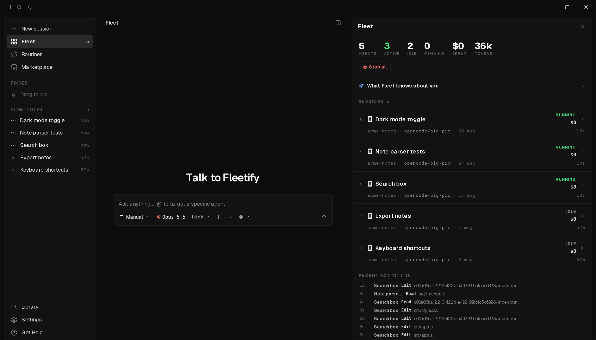
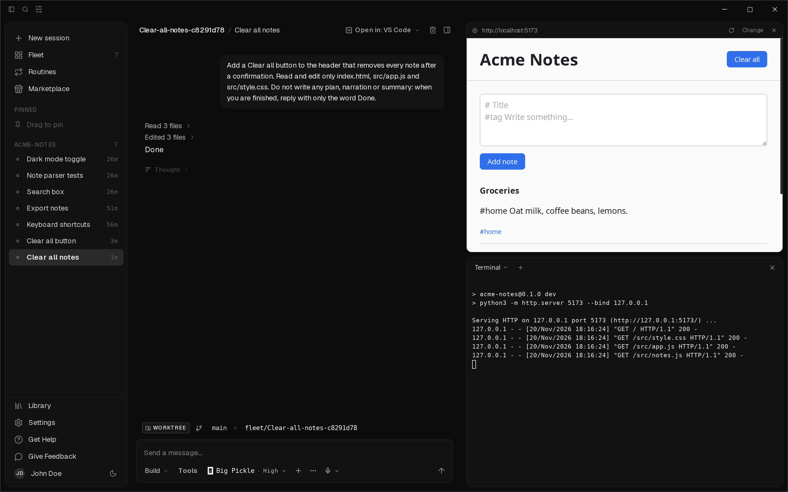
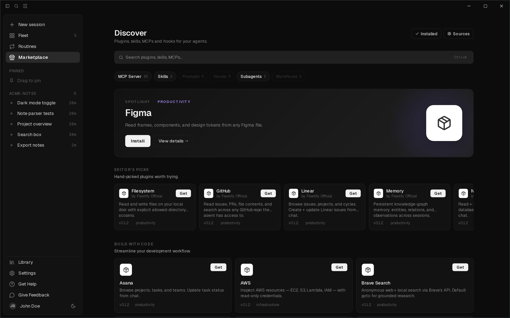

<p align="center">
  <a href="https://fleetify.dev">
    <picture>
      <source media="(prefers-color-scheme: dark)" srcset="public/logo-mark-light.svg">
      <source media="(prefers-color-scheme: light)" srcset="public/logo-mark-dark.svg">
      
    </picture>
  </a>
</p>

<h1 align="center">Fleetify</h1>

<p align="center">
  <b>A command center for AI agents.</b><br>
  Run Claude Code, Codex, OpenCode and more side by side, from one desktop app.
</p>

<p align="center">
  <a href="https://github.com/fleetifydev/fleetify/actions/workflows/ci.yml"></a>
  <a href="LICENSE"></a>
</p>

<p align="center">
  <a href="https://fleetify.dev">Website</a> ·
  <a href="#build-from-source">Build from source</a> ·
  <a href="https://github.com/fleetifydev/fleetify/discussions">Discussions</a> ·
  <a href="CONTRIBUTING.md">Contributing</a>
</p>

<p align="center"><b>English</b> · <a href="README.tr.md">Türkçe</a></p>

<p align="center">
  <picture>
    <source media="(prefers-color-scheme: dark)" srcset="docs/images/fleet-hub-dark.png">
    <source media="(prefers-color-scheme: light)" srcset="docs/images/fleet-hub-light.png">
    
  </picture>
</p>

> [!IMPORTANT]
> **Pre-release.** Fleetify is approaching its first public release (v0.2.0). Downloads, install one-liners and update support arrive with it. Until then, [build from source](#build-from-source).
>
> To hear when it ships, watch this repository (**Watch → Custom → Releases**) or follow [Announcements](https://github.com/fleetifydev/fleetify/discussions/categories/announcements).

## What Fleetify does

Running several coding agents means juggling terminals, branches and dashboards. Fleetify puts them in one window: start sessions with CLI agents or API models, follow them all from the Fleet hub, and keep parallel work apart with git worktrees.

| Feature | What it does |
|---|---|
| **Fleet hub** | Every session's status and spend, total tokens, recent activity, and a one-click *Stop all*. |
| [**Agents and models**](docs/AGENTS.md) | Claude Code, Codex, OpenCode and other CLI agents, plus OpenAI, Anthropic, Gemini and Ollama models. |
| **Git worktrees** | Give a session its own worktree and branch, and open pull requests from the app. |
| **Browser and Preview** | A built-in browser beside the chat, and a live preview of your running dev server. |
| [**Library**](docs/LIBRARY.md) | Write prompts, skills, subagents, hooks and rules once, for every agent you choose. |
| [**Marketplace**](docs/MARKETPLACE.md) | Install a plugin once, and every CLI agent it supports gets it. |
| **Routines** | Agent tasks on a schedule or on demand; scheduled ones run while Fleetify is open. |
| [**MCP sidecars**](docs/MCP_INTEGRATION.md) | Bundled MCP servers let agents hand tasks to each other and drive a headless browser. |

<p align="center">
  
  
</p>

## Agents and providers

Fleetify runs the agent CLIs you already use, such as Claude Code, Codex, OpenCode, Cursor CLI and GitHub Copilot CLI, and calls model APIs such as OpenAI, Anthropic, Gemini and OpenRouter, or a local Ollama. [docs/AGENTS.md](docs/AGENTS.md) and [docs/PROVIDERS.md](docs/PROVIDERS.md) list them, with how to set each one up.

Fleetify writes your Library items and installed plugins into each agent's own config. It also credits itself in the commits it makes and the pull requests it opens, with a `Co-Authored-By: Fleetify` line and a short footer; **Settings → General → Attribution** turns that off.

## Requirements

- **A free Fleetify account.** Release builds, including ones you build yourself, need one, since your sessions, saved API keys and fleetify.dev dashboard are tied to it. Development builds skip sign-in (`npm run dev:tauri:wt`).
- **macOS 11 or later, Windows 10 or 11, or Linux** with WebKitGTK 4.1 (Ubuntu 22.04, Debian 12 and newer).
- **An agent or a model:** an agent CLI such as Claude Code, Codex or OpenCode, an API key for a provider such as OpenAI or Anthropic, or Ollama running locally.

## Install

Downloads arrive with the first public release (v0.2.0). Until then, [build from source](#build-from-source).

| Platform | Package (from v0.2.0) | First launch |
|---|---|---|
| macOS | `.dmg` | Self-signed: macOS asks you to allow it once in **Privacy & Security** |
| Windows | `.exe` installer, per user | Unsigned: SmartScreen shows a warning |
| Linux | AppImage, `.deb`, `.rpm` | No signing prompt; make the AppImage executable first |

[docs/INSTALL.md](docs/INSTALL.md) walks through each warning and shows how to verify a download.

## Build from source

You need Git, Node 22, Rust (stable, through rustup) and the system packages for your OS, CMake and libclang included. [CONTRIBUTING.md](CONTRIBUTING.md#development-setup) has the full list.

```bash
git clone https://github.com/fleetifydev/fleetify.git
cd fleetify
npm ci
npm run dev:tauri:wt   # debug build: own data folder, skips sign-in
```

The first run compiles the whole Rust workspace, so it takes a while. A release build you compile yourself still asks for a Fleetify account.

## Privacy and telemetry

**Dashboard sync** is on by default and shows your sessions on your fleetify.dev dashboard. It sends session metadata, such as the agent, model, status, token counts, cost, title and project folder name, and never your code, prompts, commands, full paths or API keys. **Product analytics** (PostHog, EU) stays off until you turn it on. Onboarding asks about both, and **Settings → General → Privacy** switches either one at any time; [docs/ANALYTICS.md](docs/ANALYTICS.md) lists every field.

The agents and model providers you use receive your prompts and code directly, under their own terms. Voice dictation goes through Fleetify cloud by default; **Settings → Voice** switches it to your own key or **On-device**.

## How it works

Fleetify is a single Tauri v2 process. Its Rust shell embeds an axum backend on 127.0.0.1 that serves the UI, a REST API and a WebSocket. CLI agents run as local subprocesses, driven over stdio protocols such as ACP or through a terminal; API providers are called over HTTPS, and Ollama over HTTP on your machine or network. MCP sidecars, small servers that ship with the app, give the agents extra tools. [docs/ARCHITECTURE.md](docs/ARCHITECTURE.md) maps the code.

## Community and contributing

| You want to… | Go to |
|---|---|
| Ask a question | [Discussions → Q&A](https://github.com/fleetifydev/fleetify/discussions/categories/q-a) |
| Suggest a feature | [Discussions → Ideas](https://github.com/fleetifydev/fleetify/discussions/categories/ideas) |
| Report a bug | [Open an issue](https://github.com/fleetifydev/fleetify/issues/new/choose) |
| Report a vulnerability | [SECURITY.md](SECURITY.md): privately, never in a public issue |
| Talk business | [hello@fleetify.dev](mailto:hello@fleetify.dev) |

Pull requests are welcome. Read [CONTRIBUTING.md](CONTRIBUTING.md) first and sign off every commit (`git commit -s`). Everyone in the project follows the [Code of Conduct](CODE_OF_CONDUCT.md), and [SUPPORT.md](SUPPORT.md) lists where to get help.

## Licence

Fleetify is licensed under the [Apache License 2.0](LICENSE); see [NOTICE](NOTICE). The Fleetify name and logo are not licensed under it: see [TRADEMARKS.md](TRADEMARKS.md). Claude Code, Codex and the other agents and services named here are trademarks of their owners, and Fleetify is not affiliated with them.

<br>

<p align="center">
  <sub>Built in Türkiye by <a href="https://github.com/dorukozgen">Doruk Özgen</a> and <a href="https://github.com/CryonicsX">Hakan Karapınar</a>, with <a href="https://github.com/fleetifydev/fleetify/graphs/contributors">everyone who contributes</a>.</sub>
</p>
