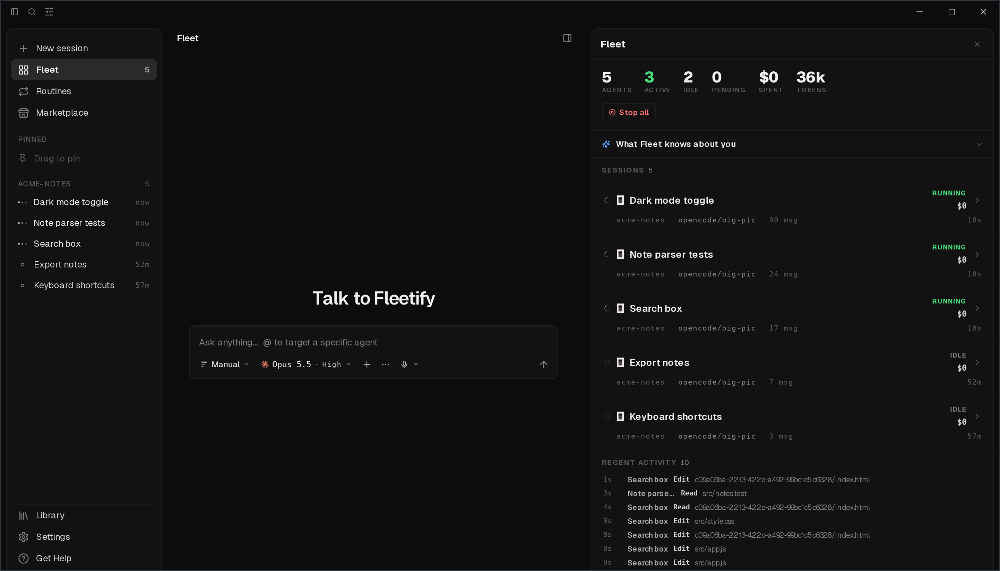

<p align="center">
  <a href="https://fleetify.dev"><picture>
    <source media="(prefers-color-scheme: dark)" srcset="public/logo-mark-light.svg">
    <source media="(prefers-color-scheme: light)" srcset="public/logo-mark-dark.svg">
    
  </picture></a>
</p>

<h1 align="center">Fleetify</h1>

<p align="center">
  <b>Yapay zekâ ajanlarınız için komuta merkezi.</b><br>
  Claude Code, Codex, OpenCode ve diğerlerini tek bir masaüstü uygulamasında yan yana çalıştırın.
</p>

<p align="center">
  <a href="https://github.com/fleetifydev/fleetify/actions/workflows/ci.yml"></a>
  <a href="LICENSE"></a><br><br>
  <a href="https://fleetify.dev">Web sitesi</a> · <a href="#kaynaktan-derleme">Kaynaktan derleme</a> · <a href="https://github.com/fleetifydev/fleetify/discussions">Discussions</a> · <a href="CONTRIBUTING.md">Katkıda bulunma</a><br>
  <a href="README.md">English</a> · <b>Türkçe</b>
</p>

<p align="center">
  <picture>
    <source media="(prefers-color-scheme: dark)" srcset="docs/images/fleet-hub-dark.png">
    <source media="(prefers-color-scheme: light)" srcset="docs/images/fleet-hub-light.png">
    
  </picture>
</p>

> [!IMPORTANT]
> **Yayın öncesi.** Fleetify ilk herkese açık sürümüne (v0.2.0) hazırlanıyor. İndirmeler, tek satırlık kurulum komutları ve güncelleme desteği bu sürümle gelecek. O zamana kadar Fleetify'ı [kaynaktan derleyebilirsiniz](#kaynaktan-derleme).
>
> Sürüm çıktığında haberdar olmak için depoyu izleyin (**Watch → Custom → Releases**) ya da [Announcements](https://github.com/fleetifydev/fleetify/discussions/categories/announcements) kategorisini takip edin.

## Fleetify ne yapar?

Birden fazla kodlama ajanıyla çalışmak; terminaller, branch'ler ve paneller arasında sürekli gidip gelmek demek. Fleetify ajanlarınızı tek pencerede toplar: CLI ajanlarıyla ya da API modelleriyle oturum başlatın, hepsini Fleet hub'dan izleyin, paralel işleri git worktree'leriyle birbirinden ayırın. Library, Marketplace, Routines, yerleşik tarayıcı ve MCP sidecar'larıyla ilgili ayrıntılar [İngilizce README](README.md)'de. Fleetify yaptığı commit'lere `Co-Authored-By: Fleetify` satırı, açtığı pull request'lerin sonuna da kısa bir not ekler; bunu **Settings → General → Attribution** bölümünden kapatabilirsiniz.

## Gereksinimler

- **Ücretsiz bir Fleetify hesabı.** Kendi derledikleriniz de dâhil, release derlemeleri giriş yapmanızı ister; oturumlarınız, kayıtlı API anahtarlarınız ve fleetify.dev paneliniz bu hesaba bağlıdır. `npm run dev:tauri:wt` ile başlatılan geliştirme derlemelerinde giriş adımı atlanır.
- **macOS 11 ve üstü, Windows 10/11 ya da Linux.** Linux'ta WebKitGTK 4.1 gerekir: Ubuntu 22.04, Debian 12 ve sonrası uygundur.
- **Bir ajan ya da model:** Claude Code, Codex ya da OpenCode gibi bir CLI ajanı, OpenAI ya da Anthropic gibi bir sağlayıcının API anahtarı veya bilgisayarınızda çalışan Ollama. Kurulum adımları [docs/AGENTS.md](docs/AGENTS.md) ve [docs/PROVIDERS.md](docs/PROVIDERS.md)'de.

## Kurulum

İndirmeler ilk herkese açık sürümle (v0.2.0) gelecek; o zamana kadar [kaynaktan derleyin](#kaynaktan-derleme). Paketler macOS'ta kendinden imzalı, Windows'ta imzasız olacak: macOS ilk açılışta **Privacy & Security** bölümünden bir kez izin vermenizi ister, Windows'ta ise SmartScreen bir uyarı gösterir. [docs/INSTALL.md](docs/INSTALL.md) her adımı ayrıntılı anlatıyor.

## Kaynaktan derleme

Derlemek için Git, Node 22, Rust (stable, rustup ile) ve işletim sisteminize göre bazı paketler (CMake ve libclang dâhil) gerekir. Tam liste [CONTRIBUTING.md](CONTRIBUTING.md#development-setup)'de.

```bash
git clone https://github.com/fleetifydev/fleetify.git
cd fleetify
npm ci
npm run dev:tauri:wt   # debug derlemesi: ayrı veri klasörü, giriş adımı yok
```

İlk çalıştırma tüm Rust kodunu derlediği için biraz sürer. Kendi derlediğiniz bir release derlemesi de Fleetify hesabı ister.

## Gizlilik ve telemetri

**Dashboard sync** varsayılan olarak açıktır ve oturumlarınızı fleetify.dev panelinizde gösterir. Ajan, model, durum, token sayıları, maliyet, oturum başlığı ve proje klasörünün adı gibi bilgileri gönderir; kodunuzu, prompt'larınızı, komutlarınızı, tam dosya yollarını ya da API anahtarlarınızı asla göndermez. **Product analytics** (PostHog, AB sunucuları) siz açmadıkça kapalı kalır. Uygulamayı ilk açtığınızda ikisi de size sorulur; **Settings → General → Privacy** bölümünden istediğiniz zaman değiştirebilirsiniz. Gönderilen alanların tamamı [docs/ANALYTICS.md](docs/ANALYTICS.md)'de listeleniyor. Kullandığınız ajanlar ve model sağlayıcıları prompt'larınızı ve kodunuzu doğrudan ve kendi koşulları çerçevesinde alır. Sesle yazdırma varsayılan olarak Fleetify cloud üzerinden çalışır; **Settings → Voice** bölümünden kendi API anahtarınıza ya da **On-device** seçeneğine geçebilirsiniz.

[Kullanım Koşulları](https://fleetify.dev/legal/terms), Fleetify hesabınızı ve uygulamanın kullandığı bulut hizmetini düzenler; [Gizlilik Politikası](https://fleetify.dev/legal/privacy) ise uygulamanın ve fleetify.dev'in neleri topladığını anlatır.

## Topluluk ve lisans

- Sorular için [Discussions → Q&A](https://github.com/fleetifydev/fleetify/discussions/categories/q-a), öneriler için [Discussions → Ideas](https://github.com/fleetifydev/fleetify/discussions/categories/ideas); hata bildirmek için [bir issue açın](https://github.com/fleetifydev/fleetify/issues/new/choose).
- Güvenlik açıklarını herkese açık bir issue'da değil, [SECURITY.md](SECURITY.md)'de anlatıldığı gibi gizlice bildirin.
- İş birliği, basın ve kurumsal konular için: [hello@fleetify.dev](mailto:hello@fleetify.dev).
- Katkıya açığız: önce [CONTRIBUTING.md](CONTRIBUTING.md)'yi okuyun ve her commit'inize `git commit -s` ile sign-off ekleyin. Projede herkes [Davranış Kuralları](CODE_OF_CONDUCT.md)'na uyar.

Fleetify, [Apache License 2.0](LICENSE) ile lisanslanmıştır ([NOTICE](NOTICE)). Fleetify adı ve logosu bu lisansın kapsamında değildir: [TRADEMARKS.md](TRADEMARKS.md). Burada adı geçen Claude Code, Codex ve diğer ajan ve hizmetler, sahiplerinin ticari markalarıdır; Fleetify'ın bunlarla bir bağlantısı yoktur.
